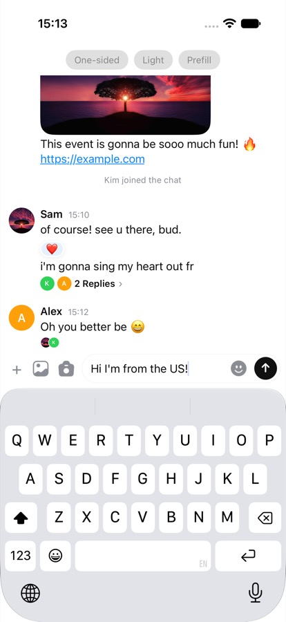
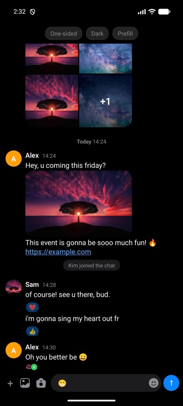
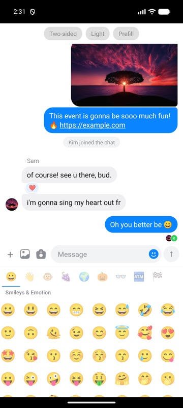
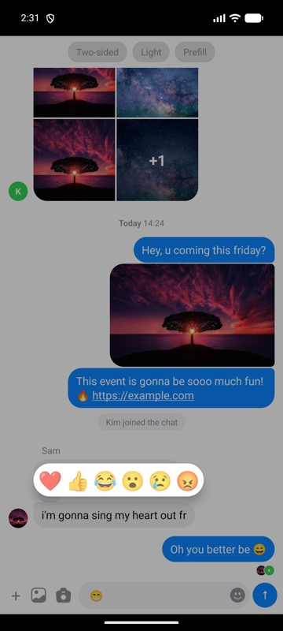

# react-native-messy

Chat UI for React Native that you can restyle and take apart piece by piece.

<p>
  
  
  
  
  
</p>

- **Two layouts**: `bubble` (yours on the right, theirs on the left) and `list` (everything on the left, Slack style)
- **Grouped bubbles**: tighter corners between consecutive messages, day separators, and delivered/seen status under your latest message
- **Rich content**: tappable links, phone numbers and emails; images and image grids; video; location
- **Interactions**: long-press reactions, swipe to reply with quotes, and "N Replies ›" thread summaries
- **Composer**: pill input with an in-pill send button, and an emoji panel where the keyboard is. Open your own panels in the same place
- **Media viewer**: full screen, swipe between items, pinch to zoom
- **Customizable at every level**: theme tokens (dark theme included), translatable texts, and 27 replaceable **slots** whose defaults are all exported

## Install

```sh
yarn add @vokhuyet/react-native-messy
yarn add @shopify/flash-list react-native-gesture-handler react-native-reanimated \
  react-native-keyboard-controller react-native-image-picker react-native-video dayjs
```

Wrap your app once:

```tsx
<GestureHandlerRootView style={{ flex: 1 }}>
  <KeyboardProvider>
    <App />
  </KeyboardProvider>
</GestureHandlerRootView>
```

## Quick start

```tsx
import { Messy, type TMessyMessage } from '@vokhuyet/react-native-messy';

function Chat() {
  const [messages, setMessages] = useState<TMessyMessage[]>([]); // newest first
  const insets = useSafeAreaInsets();

  return (
    <Messy
      messages={messages}
      user={{ id: me.id, userName: me.name, avatar: { uri: me.avatar } }}
      composerProps={{ bottomInset: insets.bottom }}
      onSend={(message) => {
        setMessages((list) => [message, ...list]); // arrives with status: 'sending'
        api.send(message); // then update its status to 'sent' or 'seen'
      }}
    />
  );
}
```

## Customize in three levels

```tsx
// 1. theme tokens
<Messy theme={{ colors: { primary: '#7C3AED', ownBubble: '#7C3AED' }, radius: { bubble: 12 } }} />

// 2. wrap a default slot
function Avatar(props: TMessyAvatarProps) {
  return <Pressable onPress={() => openProfile(props.user)}><DefaultAvatar {...props} /></Pressable>;
}

// 3. replace a slot
function SendButton({ disabled, onPress }: TMessySendButtonProps) {
  return <MyIconButton icon="send" disabled={disabled} onPress={onPress} />;
}

const components = { Avatar, SendButton }; // define outside render
<Messy components={components} />;
```

## Documentation

| | |
|---|---|
| [Getting started](docs/getting-started.md) | install, the send lifecycle, uploads, loading older messages, safe area |
| [Layouts](docs/layouts.md) | two-sided and one-sided layouts, grouping |
| [Theming and texts](docs/theming.md) | every token with its default, dark mode, translations |
| [Customization](docs/customization.md) | how slots work, the slot map, recipes (bubbles, avatars, custom message types, system messages, reaction menu, …), hooks |
| [Composer](docs/composer.md) | composer options and actions, send button, attachments, your own panels, reply bar |
| [Features](docs/features.md) | reactions, swipe to reply, threads, media and the size cache, links |
| [API reference](docs/api.md) | all props, types, ref, hooks and exports |
| [Migrating from 0.x](docs/migration.md) | old prop → new API |

Design reference: [Cal AI – Sending a message in a group](https://mobbin.com/flows/aa385ee8-cc31-4230-95fd-82fd8fde4e12) (one-sided layout, in-pill send button, reply threads), plus the two-sided pattern shared by the "Chatting & Sending Messages" flows on Mobbin. The [example app](example/src/App.tsx) applies it to both layouts.

## Contributing

See the [contributing guide](CONTRIBUTING.md) to learn how to contribute to the repository and the development workflow.

## License

MIT
