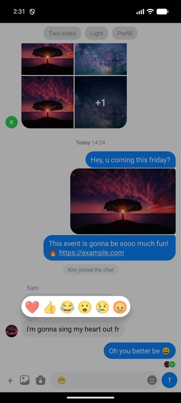

# Features

## Reactions



Reactions are off until you pass `reactions`. With it, a long press opens the picker above the message, and reaction chips appear under messages that have `reactions`.

```tsx
<Messy
  reactions={{
    data: [{ key: 'like', value: '👍' }, { key: 'love', value: '❤️' }], // optional, defaults to DEFAULT_REACTIONS
    onPress: ({ message, reaction }) => toggleReaction(message, reaction),
  }}
/>
```

`onPress` is called both from the picker and when a chip is tapped. Messy does not change your data, so update `message.reactions` yourself:

```tsx
const toggleReaction = (message: TMessyMessage, reaction: TReactionItem) => {
  const list = message.reactions ?? [];
  const mine = list.find((r) => r.user.id === me.id && r.reaction.key === reaction.key);
  update(message.id, {
    reactions: mine ? list.filter((r) => r !== mine) : [...list, { user: me, reaction }],
  });
};
```

`message.reactions` is a flat list of `{ id?, user, reaction }`. Chips are grouped by `reaction.key`, show a count when more than one person reacted, and use `colors.reactionChipActive` when you are one of them.

`onLongPressMessage` is always called on a long press, with or without `reactions`. Long press is disabled while a message is `sending`.

Customize: `ReactionPicker` and `Reactions` slots, see [Customization](customization.md#reaction-picker).

## Swipe to reply

```tsx
<Messy swipeToReply onSend={…} />
```

- Swipe a message toward the middle of the screen: other people's messages to the right, your own to the left (always to the right in the list layout). Past 56 pt a reply arrow appears, and on release the message becomes the reply target. The input is then focused.
- The `ReplyPreview` bar ("Replying to Sam") appears above the input. ✕ cancels it.
- The next message sent, text or media, has `replyTo` set to the quoted message, and the bar closes.
- A message with `replyTo` shows a quote (`MessageReply`) at the top of its bubble.

Store `replyTo` with the message on your backend. To keep payloads small you can store only the id and rebuild a light copy when loading:

```tsx
onSend={(message) => {
  api.send({ ...message, replyToId: message.replyTo?.id, replyTo: undefined });
  setMessages((list) => [message, ...list]);
}}

// when loading
const withQuotes = rows.map((r) => ({
  ...r,
  replyTo: r.replyToId ? { id: r.replyToId, text: r.replyText, user: r.replyUser } : undefined,
}));
```

The quote only needs `user` and `text` (or `image`, `video`, `location` to show "Photo", "Video" or the place name).

Messages that are `sending` or `failed` can't be swiped. Swipe to reply needs `GestureHandlerRootView` above `Messy`.

**Reply from a menu.** `setReplyTo` starts a reply without swiping, for example from your long-press menu:

```tsx
const { setReplyTo, focus } = useMessyComposerActions();
setReplyTo(message);
focus();
```

**Tapping the quote** does nothing by default. To make it open the original (a screen or a highlight), wrap `MessageReply` in a `Pressable` with your own handler. Scrolling the list to the original is not built in yet.

Customize: `MessageReply` and `ReplyPreview` slots. Texts: `replyingTo`, `you`, `photo`, `video`, `location`.

## Threads

A message with `replies` shows a summary under it with up to 3 avatars:

```ts
{ id: 'm1', text: "i'm gonna sing", user: sam, replies: { count: 2, users: [kim, me] } }
```

Messy shows only the summary. Opening the thread is up to you:

```tsx
<Messy onPressReplies={(message) => navigation.navigate('Thread', { id: message.id })} />
```

A thread screen is just another `<Messy>` with the replies as `messages`.

Customize: `ThreadSummary` slot. Texts: `reply`, `replies`.

## Images, videos and locations

| Message field | Shown as |
|---|---|
| `image: source` | one image, fitted into `mediaMaxWidth` × `mediaMaxHeight` |
| `image: [a, b, c, …]` | a 2-column grid of up to 4 tiles, with "+N" on the last one |
| `video: { uri }` | a video with a play button |
| `location: { name, image, latitude, longitude }` | the map image and the name. Tapping opens Google Maps |
| `local: Asset` | the picked file, while it uploads. Image or video is detected from `type` or the file extension |

Tapping an image or video opens the full-screen viewer. Users can swipe between all the images of that message and pinch to zoom.

A message can have `text` and media together. The text goes under the media in the same bubble.

### Sizes and the cache

Images start at a 4:3 placeholder size (videos at 16:9) and resize when they load. In a long chat this makes rows jump when they scroll back into view. Pass `cache` so known sizes are reused:

```tsx
import { MMKV } from 'react-native-mmkv';
const storage = new MMKV({ id: 'messy-media' });

const cache = {
  get: (key: string) => {
    const v = storage.getString(key);
    return v ? JSON.parse(v) : undefined;
  },
  set: (key: string, value: TMessyMediaSize) => storage.set(key, JSON.stringify(value)),
};

<Messy cache={cache} />;
```

Keys are media URIs and values are the fitted `{ width, height }`. Any synchronous key-value store works.

If an image fails to load, a placeholder with an image icon is shown at the same size.

## Links, phone numbers and emails

Text is parsed with react-native-parsed-text. URLs open in the browser, phone numbers open the dialer, and emails open the mail app. Add your own patterns with `parsedShape`; see [Customization](customization.md#text-mentions-hashtags-custom-links).

## Scroll to latest

When the user scrolls away from the newest messages, a round button appears in the bottom right. Tapping it scrolls back down. Customize it with the `ScrollToBottomButton` slot, or scroll from outside with `ref.current.scrollToEnd()`.

## Keyboard and panels

The composer follows the keyboard with react-native-keyboard-controller. The emoji panel and your own panels open at the last known keyboard height, so the layout doesn't jump when you switch between them. Dragging the list or tapping a message closes both. See [Composer](composer.md#your-own-panel-stickers-gifs-quick-replies).
